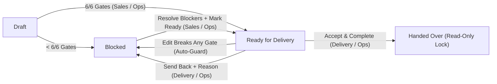

<div align="center">

# HandoffHQ

### The Sales-to-Delivery Handover Command Center for Digital Agencies

**Stop throwing closed deals over the wall.**  
HandoffHQ acts as a structured operational airlock between Sales and Delivery—enforcing an explainable, deterministic **6-Gate Readiness Engine** before the delivery team accepts responsibility for a project.

[](#)
[](#the-6-gate-deterministic-readiness-engine)
[](#quick-start--local-development)
[](#architecture--tech-stack)

</div>

---

## Why HandoffHQ Exists (The Problem)

In most digital agencies, closing a deal is celebrated—and then chaos begins.

When Sales transfers a newly signed client to the Delivery team, critical context is almost always scattered across email threads, Slack messages, call notes, and people's memories. Delivery leads are asked to kick off projects with:

- **Vague, one-line scope summaries** that invite immediate scope creep and client disputes.
- **Missing client credentials and access** (DNS, CMS, analytics, brand assets) that stall engineers in Sprint 1.
- **Unlinked SOWs or design specs** that leave the team guessing what was actually promised.
- **No formally assigned Delivery Owner**, creating an accountability vacuum during client onboarding.

> **The result:** Delayed launches, preventable rework, friction between Sales and Delivery, and eroded client trust during the most sensitive week of the engagement.

---

## Our Purpose & Solution

**HandoffHQ** is purpose-built to eliminate incomplete agency handovers.

We are **not** building another generic kanban board or bloated CRM. HandoffHQ is a **Sales-to-Delivery Command Center** built around a single operational principle:

> **A closed deal is not Ready for Delivery until it proves it is ready.**

Instead of relying on subjective checklists or unpredictable LLM opinions, HandoffHQ runs every handover package through a **deterministic 6-Gate Readiness Engine**:

1. **Centralizes the Handover Package:** Commercial baseline, scope boundaries, itemized deliverables, mandatory client dependencies, supporting documents, and ownership live in one structured workspace.
2. **Diagnoses Blockers in Real Time:** Every edit immediately re-evaluates all six operational gates, explaining **what** is failing, **why** it blocks delivery, and **how** to fix it—with one-click navigation directly to the offending field.
3. **Enforces Role-Based Accountability:**
   - **Sales** prepares the handover and resolves blockers, but cannot mark a deal *Ready for Delivery* until `6/6` gates pass.
   - **Delivery** reviews *Ready for Delivery* packages in a clean read-only inspection view and either **Accepts & Locks** the handover or **Sends It Back to Sales** with a mandatory rejection reason.
   - **Ops** oversees the entire pipeline and can intervene across statuses when needed.

---

## What the Application Does

### 1. Agency Command Center (Portfolio Overview)
- **Live Operational KPIs:** Tracks **Total Handovers & Pipeline Value**, **Blocked Handovers & Revenue at Risk**, **Awaiting Acceptance (`Ready for Delivery`)**, **Completed Handovers (`Handed Over`)**, and **Overall Gate Readiness (`%`)**.
- **At-a-Glance Gate Matrix:** Every project card displays a live `R-01` through `R-06` status matrix alongside Deal Value, Target Launch Date, Sales Owner, Delivery Owner, and the next required operational action.
- **Instant Filtering:** Filter handovers by lifecycle status (`Draft`, `Blocked`, `Ready for Delivery`, `Handed Over`), assigned **Delivery Owner** (including *Unassigned Only*), or keyword search.

### 2. The 6-Gate Deterministic Readiness Engine

Every handover is evaluated against six explicit, deterministic rules (`src/lib/readinessEngine.js`). Identical input always produces the exact same readiness score and remediation guidance:

| Gate | Requirement | Deterministic Pass Rule | Why It Matters to Delivery |
| :--- | :--- | :--- | :--- |
| **`R-01`** | **Commercial & Timeline Baseline** | Client name (`>= 2` chars), positive deal value (`> $0`), and valid target launch date (`YYYY-MM-DD`). | Prevents kicking off projects without verified commercial terms or launch targets. |
| **`R-02`** | **Scope Clarity** | Scope summary contains **at least 30 non-whitespace characters**. | Eliminates one-word placeholder scopes and sets clear delivery boundaries. |
| **`R-03`** | **Defined Deliverables** | At least **2 deliverables**, each with a valid title (`>= 3` chars) and milestone due date (`YYYY-MM-DD`). | Ensures work is broken into concrete, scheduled milestones before kickoff. |
| **`R-04`** | **Dependency Readiness** | At least **1 mandatory dependency** exists, and **every** mandatory dependency has a valid title and `is_resolved === true`. | Guarantees critical client credentials/access are verified before sprint capacity is committed. |
| **`R-05`** | **Supporting Documentation** | At least **1 attached document** with a non-empty label and a valid `http://` or `https://` URL (blocking unsafe protocols). | Ensures signed SOWs, proposals, or technical specs are linked in one place. |
| **`R-06`** | **Delivery Ownership** | Both `delivery_owner_id` and `delivery_owner_name` are formally assigned. | Establishes clear single-threaded ownership on the receiving delivery team. |

### 3. Role-Aware Handover Lifecycle & Safeguards



- **Role-Based Editing (`src/lib/workflowRules.js`):**
  - **Sales (`Aarav Mehta`)** and **Ops (`Vikram Desai`)** can create and edit handovers prior to final acceptance, and mark a `6/6` handover **Ready for Delivery**.
  - **Delivery (`Priya Nair`)** has a dedicated read-only review experience—Delivery cannot silently alter Sales's commercial or scope fields, but holds the authority to **Accept & Complete** or **Send Back to Sales**.
- **Automatic Downgrade Protection:** If a handover in `Ready for Delivery` is edited such that any of the six gates fails (`< 6/6`), the system automatically downgrades its status back to `Blocked` and records the exact reason in the activity log.
- **Immutable Post-Acceptance Lock:** Once Delivery accepts a handover (`Handed Over`), all fields and checklists lock into read-only mode to preserve an auditable record of what was agreed at kickoff.
- **Chronological Activity & Audit History:** Records every status transition, blocker resolution, Delivery kickoff note, and Send-Back rejection reason with actor role badges and timestamps.

---

## Try the 60-Second Demo Flow (*Acme Website Redesign*)

HandoffHQ ships with **4 realistic agency handovers** pre-loaded in different lifecycle states (`Blocked`, `Ready for Delivery`, `Handed Over`, and `Draft`). To experience the core workflow in under 60 seconds:

1. **Open the Blocked Deal:** Start as **Aarav Mehta (Sales)** on the Command Center and open **Acme Website Redesign ($45,000)**—currently **Blocked (`3 of 6 Gates Passed — 50%`)**.
2. **Inspect the 3 Failed Gates:** Look at the sticky **Six-Gate Readiness Engine** panel on the right to see why `R-02` (Scope Clarity), `R-04` (Mandatory Client Dependencies), and `R-06` (Delivery Owner) are blocking the handover.
3. **Resolve All 3 Blockers:**
   - **Fix `R-02`:** Click `Jump to R-02 field to fix` (or go to Section 2) and click **`✨ Insert Full Scope Summary`** (`3/6` → `4/6`).
   - **Fix `R-04`:** In Section 4 (*Client Access & Dependencies Checklist*), check **`Production DNS & Webflow Workspace Admin Access`** (`4/6` → `5/6`).
   - **Fix `R-06`:** In Section 1 (*Commercial Baseline & Delivery Ownership*), assign **`Priya Nair (Delivery Lead)`** (`5/6` → `6/6`).
4. **Submit to Delivery:** Click **`Mark Ready for Delivery (6/6 Passed)`** in the Readiness Engine panel.
5. **Switch Persona & Sign Off:** Switch the top-bar persona to **`Priya Nair (Delivery)`** (or use the one-click persona switch prompt in the panel). Test **Send Back to Sales** with a reason, or click **`Accept & Complete Handover`** to lock the project into **`Handed Over`** and inspect the **Handover Activity & Audit History**.
6. **Reset Anytime:** Click **`Reset Demo Data`** → **`Confirm`** in the top navigation bar to restore all 4 deals to their initial state.

---

## Quick Start & Local Development

### Prerequisites
- **Node.js** `v18+` and **npm**

### Commands

```bash
# 1. Install dependencies
npm install

# 2. Run the 18 automated unit & integration tests (Vitest)
npm test

# 3. Start the local development server
npm run dev

# 4. Build the production bundle
npm run build
```

---

## Architecture & Persistence Modes

```text
src/
├── components/
│   ├── Navbar.jsx              # Brand bar, storage status indicator, persona switcher & safe demo reset
│   ├── DashboardView.jsx       # Command Center KPIs, filters, and handover cards with R-01..R-06 matrix
│   ├── HandoverWorkspace.jsx   # Split-screen 6-section handover editor & read-only inspection view
│   ├── ReadinessPanel.jsx      # Sticky 6-Gate Readiness Engine, blocker diagnostics & workflow actions
│   ├── ActivityTimeline.jsx    # Chronological handover history with transition & send-back callouts
│   └── NewHandoverModal.jsx    # Modal for initiating new client handovers
├── lib/
│   ├── readinessEngine.js      # Pure, deterministic 6-gate validation engine (R-01 through R-06)
│   ├── workflowRules.js        # Role permissions, legal status transitions & auto-downgrade guard
│   └── supabaseClient.js       # Dual-mode configuration & browser-side secret key safety check
├── services/
│   └── handoverService.js      # Persistence abstraction supporting LOCAL_DEMO and SUPABASE_CONNECTED
├── constants/
│   ├── demoUsers.js            # Demo personas (Sales, Delivery Lead, Agency Ops) & delivery owners
│   └── seedData.js             # 4 fictional agency handovers for instant zero-config demonstration
└── __tests__/
    └── readinessAndWorkflow.test.js # 18 automated tests covering all gates, roles, and transitions
```

### Dual Persistence (`LOCAL_DEMO` vs. `SUPABASE_CONNECTED`)

- **`LOCAL_DEMO` (Default / Zero-Config):** Runs out of the box using browser `localStorage` (`handoffhq_v1_handovers`). No external database or API keys required.
- **`SUPABASE_CONNECTED` (Optional Cloud Persistence):**
  1. Create a Supabase project and run [`supabase/schema.sql`](./supabase/schema.sql) in the SQL Editor.
  2. Copy [`.env.example`](./.env.example) to `.env` and provide `VITE_SUPABASE_URL` and `VITE_SUPABASE_ANON_KEY`.
  3. If a cloud read or write fails, HandoffHQ surfaces an explicit warning banner and lets you switch cleanly to `LOCAL_DEMO` without silently losing work.

> [!IMPORTANT]
> **Security & Demo Scope Notes**
> - Never place a Supabase `service_role` or `sb_secret_` key in `.env` or browser code—`src/lib/supabaseClient.js` actively detects and rejects privileged keys.
> - The RLS policies in `supabase/schema.sql` allow anonymous `SELECT`, `INSERT`, and `UPDATE` (while blocking `DELETE`) so hackathon judges can switch personas freely without a login wall. Use only with fictional demo data.
